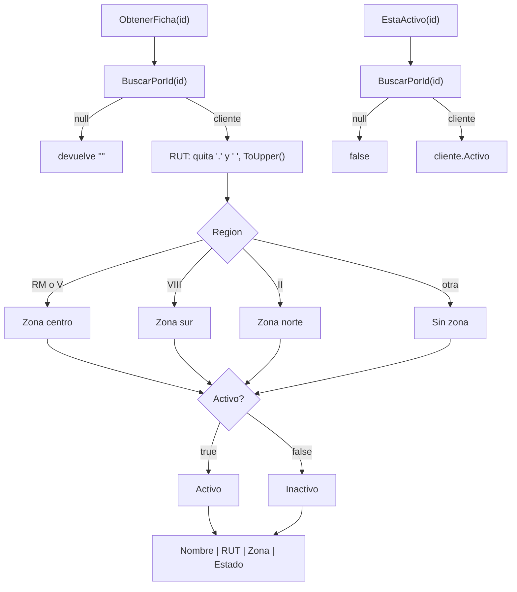

# Módulo ClientesService

> Archivo: `src/PedidosWeb.Core/Clientes/ClientesService.cs` · Namespace: `PedidosWeb.Core.Clientes`
> Tests: `tests/PedidosWeb.Core.Tests/Clientes/ClientesServiceTests.cs` (4 tests)

## Propósito

Servicio **heredado** que responde dos preguntas sobre un cliente de la distribuidora a partir de su código (`"C-001"`):

1. **¿Cómo se ve su ficha en pantalla?** Un texto de una línea: `Nombre | RUT | Zona | Estado`.
2. **¿Existe y está activo?** Un `bool`.

Trabaja sobre una lista de `Cliente` en memoria. Por defecto usa los 8 clientes ficticios de `ClientesDeEjemplo`.

Fue ordenado en la Unidad 3 sin cambiar su comportamiento: `proc2` pasó a llamarse `ObtenerFicha`, `proc3` pasó a `EstaActivo` y la búsqueda duplicada se extrajo al método privado `BuscarPorId`.

Hoy **no se usa** desde otras partes de `src/` ni está registrado en la API. El detalle del pedido (HU-02) toma los datos del cliente desde `Pedido`, no desde este servicio.

### Clases relacionadas

| Clase | Rol |
|---|---|
| `Cliente` | Modelo mutable: `Id`, `Nombre`, `Rut`, `Region`, `Activo` (los `string` parten en `""`). |
| `ClientesDeEjemplo` | `Crear()` devuelve una lista nueva con los 8 clientes de ejemplo. Los RUT vienen como en el legado: con puntos, espacios o «k» minúscula. |

## API pública

### Constructores

| Firma | Descripción |
|---|---|
| `ClientesService()` | Usa `ClientesDeEjemplo.Crear()`. |
| `ClientesService(List<Cliente> l)` | Usa la lista recibida (guarda la misma referencia, no una copia). |

### `string ObtenerFicha(string id)`

Devuelve la ficha del cliente con formato `Nombre | RUT | Zona | Estado`.

| Parte | Cómo se arma |
|---|---|
| `Nombre` | `Cliente.Nombre` tal cual. |
| `RUT` | `Cliente.Rut` sin puntos ni espacios, en mayúsculas (`76.990.011-k` → `76990011-K`). |
| `Zona` | Según `Cliente.Region`: `RM` → `Zona centro`, `V` → `Zona centro`, `VIII` → `Zona sur`, `II` → `Zona norte`, cualquier otra → `Sin zona`. |
| `Estado` | `Activo` si `Cliente.Activo` es `true`; si no, `Inactivo`. |

| Caso borde | Resultado |
|---|---|
| Id inexistente (`"C-999"`) | `""` (texto vacío). |
| Id `null` | `""` (no encuentra coincidencia). |
| Cliente inactivo | Ficha completa con estado `Inactivo` (no se oculta). |

### `bool EstaActivo(string id)`

| Caso | Resultado |
|---|---|
| Existe y `Activo == true` | `true` |
| Existe y está inactivo | `false` |
| Id inexistente o `null` | `false` |

### Método privado (para entender el flujo)

`Cliente? BuscarPorId(string id)` recorre la lista y devuelve el **primer** cliente cuyo `Id` es exactamente igual (`==`, distingue mayúsculas); `null` si no hay.

## Ejemplo de uso

Valores de los tests (`ClientesServiceTests`):

```csharp
var servicio = new ClientesService();   // 8 clientes de ejemplo

servicio.ObtenerFicha("C-001");
// → "Ferretería El Clavo | 76123456-0 | Zona centro | Activo"

servicio.ObtenerFicha("C-004");   // RUT "76.990.011-k", región V
// → "Almacén La Esquina | 76990011-K | Zona centro | Activo"

servicio.ObtenerFicha("C-999");   // → ""

servicio.EstaActivo("C-001");     // → true
servicio.EstaActivo("C-007");     // → false  (Kiosco Central, inactivo)
servicio.EstaActivo("C-999");     // → false  (no existe)
```

Con una lista propia:

```csharp
var clientes = new List<Cliente>
{
    new Cliente { Id = "C-100", Nombre = "Prueba", Rut = "11.111.111-1", Region = "RM", Activo = true }
};
var servicio = new ClientesService(clientes);
servicio.ObtenerFicha("C-100");   // → "Prueba | 11111111-1 | Zona centro | Activo"
```

## Diagrama Mermaid



## Observaciones

Anotadas tal como están hoy; no se corrigieron (cambiarlas sería cambiar comportamiento, no refactorizar).

- **RM y V comparten zona con dos ramas separadas.** Ambas dan `Zona centro`; el resultado es correcto para Santiago y Valparaíso, pero la regla está duplicada.
- **Solo 4 regiones mapeadas.** Cualquier otra región, o una región en minúsculas (`"rm"`), da `Sin zona`.
- **`ToUpper()` depende de la cultura** del equipo donde corre. Para RUT (dígitos y `K`) no cambia el resultado hoy, pero `ToUpperInvariant()` sería lo esperable.
- **El RUT no se valida.** Solo se quitan puntos y espacios; no se verifica el dígito verificador ni el formato. Otros separadores (tabulaciones, guiones extra) pasan tal cual.
- **"No existe" se informa con `""`**, no con `null`: quien llama no puede distinguir fácilmente un error de una ficha vacía.
- **La búsqueda por `Id` distingue mayúsculas** (`"c-001"` no encuentra a `C-001`).
- **El constructor no valida la lista.** Con `null`, el error aparece recién al llamar a un método (`NullReferenceException`).
- **Comparte la lista recibida.** Cambios externos a esa `List<Cliente>` se ven en el servicio.
- **Nombres de tests heredados.** Los tests aún se llaman `Proc2_…` y `Proc3_…` aunque los métodos ya se renombraron.
- **Sin uso en la aplicación.** Ningún endpoint ni servicio lo consume hoy.
