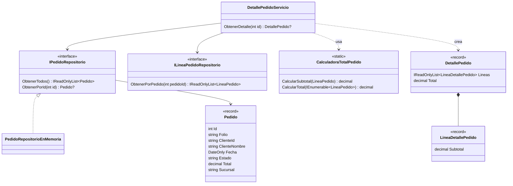

# Módulo Pedidos

> Carpeta: `src/PedidosWeb.Core/Pedidos/` · Namespace: `PedidosWeb.Core.Pedidos`
> Tests: `tests/PedidosWeb.Core.Tests/Pedidos/`

## Propósito

Reúne el modelo de **pedido** que viene del sistema legado, su acceso a datos y el **detalle de un pedido** para el vendedor (HU-02): datos del pedido, cliente, líneas con subtotal y total.

Hoy los datos viven en memoria (45 pedidos ficticios de septiembre y octubre de 2026); desde la Unidad 5 se reemplazan por PostgreSQL detrás de las mismas interfaces.

| Clase | Tipo | Rol |
|---|---|---|
| `Pedido` | `record` | Un pedido tal como viene del legado. |
| `IPedidoRepositorio` | interfaz | Acceso a los pedidos. |
| `PedidoRepositorioEnMemoria` | clase | Implementación con 45 pedidos de ejemplo. |
| `CalculadoraTotalPedido` | clase estática | Subtotales y total a partir de las líneas. |
| `LineaDetallePedido` | `record` | Una línea dentro del detalle, con su subtotal. |
| `DetallePedido` | `record` | El detalle completo de un pedido. |
| `DetallePedidoServicio` | clase | Arma el `DetallePedido` desde los repositorios. |

Depende de `PedidosWeb.Core.Lineas` (`LineaPedido`, `ILineaPedidoRepositorio`). No usa `ClientesService`: los datos del cliente salen del propio `Pedido`.

## API pública

### `Pedido` (record)

```csharp
public sealed record Pedido(
    int Id, string Folio, string ClienteId, string ClienteNombre,
    DateOnly Fecha, string Estado, decimal Total, string Sucursal);
```

| Campo | Contenido |
|---|---|
| `Id` | Número correlativo del pedido. |
| `Folio` | Formato `PED-{SUCURSAL}-{NUMERO}`, por ejemplo `"PED-STGO-000008"`. |
| `ClienteId` / `ClienteNombre` | Código (`"C-001"`) y nombre del cliente. |
| `Fecha` | Fecha de emisión, sin hora (hora local de Chile). |
| `Estado` | Texto tal como lo guarda el legado: `Pendiente`, `Confirmado`, `Despachado`, `Entregado`, `Anulado`. |
| `Total` | Total en CLP (`decimal` sin decimales), guardado por el legado. |
| `Sucursal` | Código de la sucursal (`STGO`, `ANT`, `CON`, `VAL`). |

### `IPedidoRepositorio` / `PedidoRepositorioEnMemoria`

| Método | Devuelve | Casos borde |
|---|---|---|
| `IReadOnlyList<Pedido> ObtenerTodos()` | Los 45 pedidos, sin filtros ni orden garantizado. | — |
| `Pedido? ObtenerPorId(int id)` | El pedido con ese id. | Id inexistente (p. ej. `999`) → `null`. |

### `CalculadoraTotalPedido` (estática)

| Método | Devuelve | Casos borde |
|---|---|---|
| `decimal CalcularSubtotal(LineaPedido linea)` | `Cantidad × PrecioUnitario`. | `linea` nula → `ArgumentNullException`. |
| `decimal CalcularTotal(IEnumerable<LineaPedido> lineas)` | Suma de los subtotales. | Lista vacía → `0`. `lineas` nula → `ArgumentNullException`. |

### `LineaDetallePedido` (record)

```csharp
public sealed record LineaDetallePedido(
    int Numero, string Producto, int Cantidad, decimal PrecioUnitario, decimal Subtotal);
```

### `DetallePedido` (record)

```csharp
public sealed record DetallePedido(
    int Id, string Folio, DateOnly Fecha, string Estado, string Sucursal,
    string ClienteId, string ClienteNombre,
    IReadOnlyList<LineaDetallePedido> Lineas, decimal Total);
```

`Lineas` va ordenada por `Numero`. `Total` es la suma de los subtotales de las líneas (no se copia de `Pedido.Total`).

### `DetallePedidoServicio`

| Miembro | Descripción |
|---|---|
| `DetallePedidoServicio(IPedidoRepositorio pedidos, ILineaPedidoRepositorio lineas)` | Ambos obligatorios; si alguno es nulo → `ArgumentNullException`. |
| `DetallePedido? ObtenerDetalle(int id)` | Detalle del pedido. Id inexistente → `null`. Pedido sin líneas → lista vacía y `Total = 0`. |

Se publica en la API como `GET /api/pedidos/{id}/detalle` (200 con el detalle, 404 si no existe), registrado como singleton en `src/PedidosWeb.Api/Program.cs`.

## Ejemplo de uso

Con los datos de ejemplo (tomado de `DetallePedidoServicioTests` y `CalculadoraTotalPedidoTests`):

```csharp
var servicio = new DetallePedidoServicio(
    new PedidoRepositorioEnMemoria(),
    new LineaPedidoRepositorioEnMemoria());

DetallePedido? detalle = servicio.ObtenerDetalle(8);
// detalle.Folio         → "PED-STGO-000008"
// detalle.ClienteId     → "C-001"
// detalle.ClienteNombre → "Ferretería El Clavo"
// detalle.Estado        → "Entregado"
// detalle.Lineas        → 3 líneas (números 1, 2, 3)
// detalle.Total         → 120100

servicio.ObtenerDetalle(999);   // → null

var linea = new LineaPedido(8, 2, "Mantequilla 250 g", 12, 2950m);
CalculadoraTotalPedido.CalcularSubtotal(linea);                     // → 35400
CalculadoraTotalPedido.CalcularTotal(Array.Empty<LineaPedido>());   // → 0
```

Respuesta de `GET /api/pedidos/8/detalle`:

```json
{
  "id": 8, "folio": "PED-STGO-000008", "fecha": "2026-10-20",
  "estado": "Entregado", "sucursal": "STGO",
  "clienteId": "C-001", "clienteNombre": "Ferretería El Clavo",
  "lineas": [
    { "numero": 1, "producto": "Harina para pan 25 kg", "cantidad": 3,  "precioUnitario": 21500, "subtotal": 64500 },
    { "numero": 2, "producto": "Mantequilla 250 g",     "cantidad": 12, "precioUnitario": 2950,  "subtotal": 35400 },
    { "numero": 3, "producto": "Bebida cola 1,5 L",     "cantidad": 10, "precioUnitario": 2020,  "subtotal": 20200 }
  ],
  "total": 120100
}
```

## Diagrama Mermaid



## Observaciones

Anotadas tal como están hoy; no se corrigieron.

- **Dos fuentes para el total.** `Pedido.Total` lo guarda el legado y `DetallePedido.Total` se calcula desde las líneas. Hoy coinciden en los 45 pedidos (test CA-05), pero nada impide que diverjan con datos reales.
- **Pedido sin líneas.** Si un pedido existe pero no tiene líneas, el detalle devuelve `Total = 0` aunque `Pedido.Total` sea distinto de 0. En los datos de ejemplo no ocurre.
- **`Estado` es texto libre.** No hay enum ni validación; los 5 valores salen de los datos del legado.
- **Sin validación de cantidades ni precios.** `CalculadoraTotalPedido` acepta cantidades o precios negativos o en 0.
- **`ObtenerTodos()` expone el arreglo estático.** Devuelve el `Pedido[]` interno como `IReadOnlyList<Pedido>`; un llamador podría convertirlo a arreglo y modificar los datos compartidos.
- **`LineaDetallePedido.Subtotal` no se valida.** Es un record público: se puede construir con un subtotal que no sea `Cantidad × PrecioUnitario`. El servicio siempre lo calcula bien.
